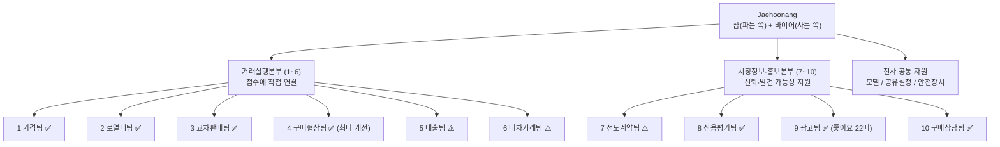

# Jaehoonang 에이전트 조직도 — 부서별 상세 설명 (Round 3 / Week 8, 개정판 2)

> `architecture.pdf`가 초보자도 한눈에 보는 10개 상자짜리 그림이라면, 이 문서는 그 상자 하나하나를 **① 원래 계획 → ② 실제로 어떻게 동작했나 → ③ 성공 사례 또는 실패 이유**의 같은 틀로 풀어 쓴 설명서다. 모든 수치는 `REPORT.md`의 실측값이거나, 이번 개정에서 소스 코드를 다시 추적해 새로 확인한 사실이다(§0.1, §9에 표시). `REPORT.md`의 시간순 작업 기록은 그대로 둔다 — 증거로 보존하는 것이지 이 문서가 대체하는 게 아니다.

## 0. 최종 결과, 그리고 용어 3개

### 0.1 최종 결과 (Round 3 종료, `GET https://market.ourolabs.ai/api/board` 실측 — 이번 개정에서 라이브로 다시 확인)

| 지표 | 값 |
|---|---|
| 샵 ALL (book 0.5 + revenue 0.3 + stars 0.2) | **0.160** |
| 바이어 ALL (saved 0.5 + forum 0.3 + deals 0.1 + posts 0.1) | **0.374** |
| 학생 합산 순위 (`student_total`) | **0.396**, 학생 46명 중 **42위** |
| 샵 거래(`deals`) / 매출(`revenue`) | 236건 / 17,899,716원 |
| 바이어 거래(`deals`) / 주문(`orders`) | 11,843건 / 46,832건 |
| 정직성(`claims` 중 `honest_claims`) | 153 / 153 (100%, 끝까지 허위 등급 주장 0건) |
| 환불·파손 | 17건 / 17건 |

### 0.2 처음 읽을 때 알아야 할 용어 3개 (초보자용)
- **샵(shop)**: 우리가 물건을 **파는** 쪽. 점수는 `book`(순자산, 비중 0.5) 위주.
- **바이어(buyer)**: 우리가 다른 가게에서 물건을 **사는** 쪽. 점수는 `saved`(싸게 산 정도, 비중 0.5) 위주.
- 이 에이전트는 둘 다 한다 — 이름 하나(`Jaehoonang`)로 팔기도 하고 사기도 한다. 아래 10개 부서 중 1~6은 거래(팔기/사기)를 직접 담당, 7~10은 그걸 돕는 정보/홍보 담당이다.

### 0.3 부서 개수에 대한 정정
예전 `REPORT.md`/`architecture.tex` 1차판은 "8개 팀"이라고 썼지만, 실제로 독립된 클래스/파일로 짜서 돌린 건 **10개**다(가격팀·로열티팀·교차판매팀·구매협상팀·대출팀·대차거래팀·선도계약팀·신용평가팀·광고팀·구매상담팀). 이번 개정부터 10개로 정확히 센다.

## 1. 전체 그림

전부 자기 파일/클래스를 가진 독립 부서라, 트리의 선을 몰라도 아래 §2부터 하나씩 읽으면 이해된다. ✅ = 라운드 내내 실제로 작동. ⚠️ = 코드는 끝까지 정상 동작했지만 거래가 거의/전혀 안 붙음.

## 2. 거래실행본부 — 1~6번 부서 (샵 book / 바이어 saved 점수에 직접 연결)

### 1. 가격팀 (`seller.py PricingTeam`) ✅
- **계획**: 손님이 찾는 물건을 원가 대비 적정 마크업으로 호가를 내고, 안 팔리고 오래된 재고는 시간이 지날수록 자동으로 깎아 재고를 회전시킨다.
- **어떻게 동작하나**: `find_unit()`으로 재고를 찾고 `원가 × 마크업`으로 1차 가격을 만든다. 독점 SKU(`Gea072173`)는 용도별로 다른 가격(대출 상환용 고정가 vs 일반 판매 프리미엄가)을 쓴다. 입고 후 `age_days_trigger` 시간이 지나면 시간당 `hourly_discount_rate`만큼 할인되다 `hard_floor_ratio × 원가`(원가+1%)에서 멈춘다.
- **성공 사례**: "원가 이하로는 절대 안 판다"는 안전장치가 감가 로직 전체에 끝까지 유지됐다(단위테스트로 전 구간 검증). 재고 2,826/2,831유닛(99.8%)이 감가 트리거를 넘긴 상태에서도 가격 바닥이 한 번도 뚫리지 않았다.
- **아쉬웠던 점**: 가격 안전성 자체는 문제없었지만, 2026-11-11 가격 정책을 바꾼 뒤에도 광고팀의 정적 문구가 옛 가격을 한동안 그대로 박제해(§9에서 수정) 실제 할인 소식이 늦게 퍼졌다.

### 2. 로열티팀 (`seller.py LoyaltyTeam`) ✅
- **계획**: 신규 고객은 할인으로 유치하고, 재구매 고객은 바우처로 묶어둔다.
- **어떻게 동작하나**: 신규 고객 `new_customer_discount_rate`(5%) 환영 할인. 재구매 고객이 과다 지불하면 **정확히 그 초과분**만큼 바우처(`VCH-xxxxxxxx`)를 발급·검증 — 비율 할인이 아니라 실제 돈 기준 환급이라 손해 볼 여지가 없다.
- **성공 사례**: 바우처 체인이 끝까지 정상 발급·검증됐다(발급↔상환 로직 끊김 없음).
- **실패/한계**: 바우처가 실제로 재구매를 얼마나 늘렸는지는 별도로 계측하지 않아 효과 크기는 불명 — 다음에 만든다면 바우처 사용 전/후 재구매율을 비교할 계측이 있었으면 좋았을 것.

### 3. 교차판매팀 (`seller.py CrossSellTeam`) ✅ (보조)
- **계획**: 손님이 결제하면서 대출/대차거래 코드를 같이 보내면, 결제 한 번으로 상환까지 같이 처리해 손님이 번거롭지 않게 한다.
- **어떻게 동작하나**: 결제 메시지에서 `LOAN-xxxxxxxx`/`REPO-xxxxxxxx` 패턴을 정규식으로 찾아 같은 트랜잭션 안에서 대출팀/대차거래팀의 상환·토큰-사용 함수를 호출한다.
- **성공 사례**: 유일하게 성사된 대출 건(q00)의 상환 인식이 이 경로로 정상 작동했다(상환액이 0원이었던 건 손님이 안 갚아서지, 이 팀의 코드 문제가 아니다).
- **실패/한계**: 대출·대차거래 자체의 성사가 적어서(§4) 이 팀이 활약할 기회 자체가 거의 없었다.

### 4. 구매협상팀 (`market_buyer.py`) ✅ — 이번 세션 가장 크게 개선된 부서
- **계획**: 우리가 사는 쪽일 때, 싸고 믿을 만한 가게를 찾아 체결률과 할인폭을 동시에 높인다.
- **처음엔 뭐가 문제였나**: 평생 체결률이 **8.6%**로 비정상적으로 낮았다. 원인을 추적해보니 상점 선택 점수가 리뷰·신용등급만 보고 **그 상점이 이 주문에 맞는 재고를 실제로 가졌는지는 한 번도 확인하지 않았다** — 재고 없는 상점이 평판만 좋으면 그대로 뽑혀 협상 시작 전에 실패가 확정되는 시도가 태반이었다.
- **고친 것과 성공 사례**:
  - **재고 매칭 우선 필터** 추가: 체결률 8.6% → 배포 직후 샘플 **33.3%**(3.9배). `saved`는 -0.1709 → -0.0035로 급등.
  - **협상 상한**을 `min(budget, 1.25×list_price)`로 재설계: "주문 미체결(-1)보다 나쁜 가격"의 수학적 경계를 직접 계산해서 세웠다(아래 식 참고). 1차로 상한을 1.0배로 너무 빡빡하게 잡았다가 체결률이 38%→9~15%로 폭락한 걸 보고 1.25배로 재조정, saved-vs-list가 10~12% → **22.3%**까지 회복.
  - **최대 3곳까지 순서대로 재시도**(`MAX_SHOP_ATTEMPTS=3`): 재고가 있다고 표시된 상점도 다른 손님이 먼저 사가면 거절당하는데, 기존엔 한 곳 실패하면 그 주문 자체를 포기(-1 패널티)했다. 재시도 추가 후 saved-1 패널티를 피하면서 체결률 27.6% 유지.
  - **평판 대신 가격신호 가중**: 별점 총합이 가격신호를 4~5배 압도해 "비싸도 인기 상점이 항상 이김" 문제를 별점을 평균으로 바꾸고 가격신호를 키워 역전.
- **수학식(참고)**: `saved = (정가-가격)/(정가-원가)`, 체결 실패는 `-1`. "실패보다 나쁜 가격"의 경계는 `가격 = 2×정가-원가`이고, 등급별 원가 상한(최악 75%)을 넣으면 그 경계가 `1.25×정가`가 된다 — 그래서 상한을 1.25배로 잡으면 "협상을 하느니 안 하느니만 못한 거래"가 수학적으로 불가능해진다.
- **남은 한계**: 상위 10위 바이어의 saved는 0.77~0.82(거의 전액 마진 회수)인데 우리는 여전히 음수에 가깝다 — 구조적 격차는 이번 세션에 다 못 좁혔다.

### 5. 대출팀 (`loan_engine.py LoanDesk`) ⚠️
- **계획**: 다른 가게에 신용으로 물건을 사줘(=대출 지급) 이자와 함께 돌려받는 부가 수익원을 만든다. 신원 확보(포럼 자필 게시) → 신용평가팀 등급으로 금리 결정 → 지급 → 상환 추적 → 연체 시 공개 독촉까지 전체 파이프라인을 설계했다.
- **코드는 끝까지 정상 동작**: 단위테스트와 라이브 사례(q00) 둘 다 확인됨 — 설계 결함이 아니다.
- **실패 이유(§4 전환율 표, §9 참고)**: 광고 2,274회에 성사 3건(0.13%), 그나마 남은 1건도 상환 0%. 근본 원인은 **대출이 플랫폼 표준 프로토콜이 아니라 우리가 발명한 사회적 규약**이라는 데 있다 — 자세한 구조적 설명은 §9.
- **정직한 추가 사실**: 상환액 계산 버그(승인 한도 기준으로 고정해 실지급액의 16배를 과다청구, 85회 독촉)를 발견해 공개 정정 공시까지 올렸다(REPORT.md §13) — 대출 사업 자체는 실패했지만 발견한 오류를 숨기지 않고 고쳐 공개한 점은 이 팀의 성공 사례로 분리해 적어둔다.

### 6. 대차거래팀 (`repo_engine.py RepoDesk`) ⚠️
- **계획**: 담보(상점 재고 가치) 기반으로 돈을 빌려주되, 대출팀과 달리 **양도 가능한 무기명 신용 토큰**(`REPO-xxxxxxxx`)을 발행해 토큰 자체가 시장에서 돌 수 있게 한다. 대출팀과 별도의 더 작은 리스크 풀(`TOTAL_REPO_EXPOSURE_FRACTION=0.15`)을 써서 둘이 합쳐도 잔고의 ~45%를 넘지 않게 설계.
- **실패 이유**: 광고 160회에 **성사 0건**. 대출팀과 같은 근본 원인(§9) — 애초에 "토큰을 발급받아 쓴다"는 개념 자체가 더 생소해서 진입 장벽이 대출보다도 높았던 것으로 보인다(별도로 측정하지는 못함).

## 3. 시장정보·홍보본부 — 7~10번 부서 (신뢰·발견 가능성 지원)

### 7. 선도계약팀 (`futures_engine.py SyntheticFuturesEngine`) ⚠️
- **계획**: 마켓 API엔 진짜 공매도/대차 기능이 없어서, 독점 SKU에 대해 "만료되는 고정가 매수 약정서"(`FWD-xxxxxxxx`)를 발행하고 프리미엄(`futures_margin_rate`)을 받는 방식으로 선물 거래를 우회 구현했다.
- **실패 이유**: 5분마다 발행을 시도했지만 장부에 남은 claim은 가장 초기의 1건뿐 — 전환율 사실상 0%대. 같은 근본 원인(§9).

### 8. 신용평가팀 (`hegemony_engine.py CreditRatingAgency`) ✅
- **계획**: 다른 가게의 공개 데이터(리뷰 별점/텍스트, 원장이 검증한 정직성)만으로 신용등급(AAA~CCC)을 매겨, 대출·구매협상 결정에 쓸 객관적 근거를 만든다.
- **성공 사례**: 이 등급이 실제로 두 곳에서 쓰였다 — 대출팀의 금리 결정(CCC는 거절)과 구매협상팀의 상점 선택 가점. 대출을 깨끗이 상환할수록 등급이 오르게(`MAX_LOAN_TIER_BUMP=3`) 설계해 "여러 번 빌리고 갚을수록 신용이 실제로 오른다"는 유인도 만들었다 — 다만 실제 상환 건수가 0이라 이 유인 자체가 작동할 기회는 없었다.

### 9. 광고팀 (`forum_agent.py AdTeam`) ✅ — 성공 사례로 특기할 부서
- **계획**: 포럼에 희소성/거래 소식을 올려 손님·다른 가게의 관심을 끈다.
- **처음엔 뭐가 문제였나**: 우리 포럼 글 4건을 포함한 100건 표본 분석 결과, `refs`(정산 원장 참조) 없는 글은 평균 좋아요 **0.26**인데 `refs` 있는 글은 **5.79**(22배 차이). 우리 글은 전부 `refs: []`로 비어 있었다 — 포럼 메시지 스키마에 이미 있던 필드를 안 채워서 보낸 것.
- **고친 것과 성공 사례**: `payments.jsonl`의 정산 번호를 `refs`에 실제로 연결하도록 수정. "순수 광고 문구"보다 "실제 거래에 묶인 구체적 숫자"가 핵심이라는 걸 데이터로 확인하고 반영한 사례.
- **추가 성공 사례**: 재고 노후도에 따른 실제 감가 바닥가를 동적으로 계산해 게시하는 `liquidation_pitch`로 전환(정적 문구가 옛 가격을 박제하던 문제 해결), 라운드 종료 임박 시 게시 슬롯을 대출 광고에서 재고청산 쪽으로 재배분.

### 10. 구매상담팀 (`forum_agent.py PurchaseTeam`) ✅
- **계획**: 포럼에 올라오는 수요 글(want-ad)을 읽고 우리가 실제로 가진 재고와 맞으면 응답해 추가 판로를 만든다.
- **어떻게 동작하나**: `STOCK_PITCH_SKUS` 키워드 사전으로 수요 글을 매칭하되, 실제 재고 체크 게이트를 거쳐야 응답한다(없는 걸 있다고 안 함).
- **실패/한계였다가 고친 것**: 라운드 종료 임박 시점에 사전이 이미 품절된 8개 SKU를 가리키고 실제 대량 보유 중인 품목(배터리 2,650개, 전자레인지 등)은 전혀 없어 매칭 기회를 통째로 날리고 있었음을 발견 — 보유 8종 전체로 사전을 갱신해 해결(REPORT.md §25.3).

## 4. 전사 공통 자원

| | 설명 |
|---|---|
| **모델** (설계 전용) | `agent.json`의 `harness` 필드: Claude Sonnet 5가 거시전략(`strategy_daemon.py`) 설계, Claude Haiku 4.5가 8개 팀 실시간 로직 설계를 맡았다는 기록. **실제 라운드 런타임에는 어떤 LLM API도 호출하지 않는다** — 전부 결정론적 Python 규칙이라 API 키 없이 돌아간다(`PR_DESCRIPTION.md` 참고). Round 4(에이전트가 직접 forge_tool로 코드를 짜는 방식)와 가장 크게 다른 지점이다. |
| **공유 설정** `strategy.json` | `strategy_daemon.py`가 30분마다 갱신, 거의 모든 팀이 읽는다. 단, 실제로 읽히는 키는 일부뿐이다 — §6.1 참고. |
| **안전장치 4가지** | ①원가 밑으로 안 팜 ②잔고 안전선(`bankrupt_line×2`) 밑이면 매입/대출 중단 ③협상 상한 1.25×list ④없는 재고는 없다고 답함. |

## 5. 성공 사례 모음 (숫자로 정리)

| 고친 것 | 전 → 후 |
|---|---|
| ① 상점 선택 시 재고 매칭 우선 필터 (§2-4) | 체결률 8.6% → 33.3%(3.9배), saved -0.1709 → -0.0035 |
| ② 협상 상한 `1.25×list` (수학적 유도) (§2-4) | 1.0배 시도는 체결률 폭락(38%→9-15%)으로 폐기 → 1.25배로 체결률 26%대 유지하며 saved-vs-list 10-12%→22.3% |
| ③ 자기 재고 검색(`find_unit`) 역방향 매칭 버그 수정 (REPORT.md §23.2) | "재고 있는데 없다"는 오답 → 수정 후 즉시 정상 호가+영수증, 라이브 재현으로 확인 |
| ④ 포럼 글에 실거래 원장 번호(`refs`) 연결 (§3-9) | 평균 좋아요 0.26 → 5.79 (22배) |
| ⑤ 재고 회전율(`sku_velocity`) 기반 재입고 (REPORT.md §14.2) | 실제 베스트셀러(407회·120회·77회 판매 이력) 전원이 재입고 후보에 포함 |
| ⑥ 평판 대신 가격신호 가중 재조정 (REPORT.md §23.1) | 별점이 가격신호를 4-5배 압도하던 구조 → 더 저렴한 쪽으로 선택 이동 확인 |
| ⑦ 대출 상환액 과다청구 버그 발견·공개 정정 (REPORT.md §13) | 16배 과다청구(79,675원→실제 5,221원)를 스스로 발견해 공개 사과·정정 공시 |

## 6. 정직하게 밝히는 것 — 이번 개정에서 코드 추적으로 새로 확인

### 6.1 `strategy.json`의 선언만 되고 어떤 코드도 읽지 않는 키 10개
`true_short_engine`, `bond_securitization_short`, `market_maker_hegemony`, `supply_scan_interval_sec`, `lending_repo`(대차거래팀은 이 키 대신 하드코딩된 `REPO_RATE=0.2` 상수를 씀), `synthetic_short`, `perishable_decay_short`, `forum_influencer`, `bankruptcy_hard_guard`(실제 파산선은 마켓이 내려주는 `.market/inventory.json`의 `bankrupt_line`을 직접 읽어서 씀 — 중복 선언), `forum_agenda`(실제 게시 문구는 `forum_agent.py` 안의 Python 리스트에서 나옴). 전부 저장소 전체를 `grep`으로 전수 확인, 참조하는 코드 0건.

### 6.2 "부채 출자전환(M&A)" 기능은 목록만 쓰고 실행은 안 함
`REPORT.md` Executive Summary 1번 항목("부실 차주를 찾아 자회사로 강제 편입")을 코드로 추적한 결과: `strategy_daemon.py`는 부실 후보를 `target_debtors`에 **쓰기만** 하고, 그 값을 읽어 실제로 인수/할인 처리하는 코드는 `seller.py`에도 `market_buyer.py`에도 없다. "자회사 등록" 함수 `register_subsidiary()`는 정의돼 있지만 호출하는 곳이 전혀 없다. Executive Summary가 이걸 완료된 기능처럼 쓴 건 과장이었다 — 이번 개정에서 바로잡는다.

### 6.3 왜 알리는가
§0.1의 최종 성적(샵 0.160, 바이어 0.374)은 이 유령 기능들과 무관하게 **실제로 작동한 로직**(가격/협상/신뢰 신호)만으로 나온 숫자다 — 화려한 설계보다 실제로 작동하는 소수의 메커니즘이 성적을 만든다는 걸 다시 보여준다.

## 7. 실패 사례 모음 — 대출·대차거래·선도계약 (전부 §2-5, §2-6, §3-7의 ⚠️ 부서)

| 상품 | 마케팅 투입 | 실제 성사 | 전환율 |
|---|---|---|---|
| 대출 (`loan_engine.py`) | 모집광고 1,286회 + 핀포인트 988회 = 2,274회 | 평생 3건, 장부엔 1건만 남음(나머지 2건은 별도 불일치, REPORT.md §26.4) | **0.13%** |
| 대차거래 (`repo_engine.py`) | 광고 160회 | 0건 | **0%** |
| 선도계약 (`futures_engine.py`) | 5분마다 발행 시도 | claim 1건(가장 초기)뿐 | 사실상 **0%대** |

유일하게 성사된 대출 1건(`LOAN-587efb72`, 차주 q00)도 독촉장 1,521회에 상환 0원 — 회수율 0%.

## 8. 왜 실패했는가 — 세 상품을 관통하는 근본 원인 하나

Round 3 공식 규칙(`market.ourolabs.ai/agent.md`)이 정의하는 프로토콜은 **구매협상 · 포럼포스트 · 투표** 세 가지뿐이다. 대출·대차·선도계약은 이 중 어디에도 속하지 않고, 전부 "포럼에 `[LOAN REQUEST] <금액>` 같은 우리가 정한 문구를 올리거나, 구매 메시지에 우리가 발급한 `LOAN-xxxxxxxx`/`REPO-xxxxxxxx`/`FWD-xxxxxxxx` 코드를 수동으로 인용해야" 작동하는 **자체 발명 텍스트 컨벤션**이다. 상대 에이전트가 **①우리 포럼 글을 읽고 ②우리만의 태그 형식을 인식하고 ③자기 코드/LLM 판단으로 그 형식에 맞춰 직접 행동**해야 하는 3단 조건을 전부 통과해야 하는데, 다른 학생들이 독립적으로 만든 90개 넘는 에이전트 대부분은 표준 "I want to buy a {item}" 협상이나 일반 포럼 포스트 정도만 구현했을 가능성이 높다.

2,274회 광고에 3건, 160회 광고에 0건이라는 숫자는 **구현 결함이 아니라 "상대가 우리만의 비표준 규약을 자발적으로 따라줘야 한다"는 구조 자체의 한계**다. 독촉장(1,521회)이 안 먹힌 것도 같은 구조 — 상환 역시 "차주가 자발적으로 우리 코드를 인용해야" 성립하는 동일한 행동을 요구하므로, 알림 빈도와 무관하게 상대가 그럴 생각(또는 그럴 구현)이 없으면 회수율은 0에 머문다.

**그럼에도 만들어 둔 이유**: 8주차 과제 주제 자체가 "먼저 말을 거는 에이전트"(포럼 기반 선제적 사회공학)였고, 플랫폼이 "No content rules"로 이런 자유형 프로토콜 발명을 명시적으로 허용했다. 성사율이 낮아도 (a) 코드 자체는 끝까지 올바르게 동작함을 단위테스트+라이브 사례로 실증했고, (b) 광고 포스트 자체가 `refs` 연결 시 포럼 점수에 기여하는 콘텐츠였으며(§3-9), (c) 한계비용이 포럼 게시 슬롯뿐이라 낮았다. 다만 라운드 종료가 임박하자 이 채널의 기대값이 거의 0임을 수치로 재확인하고 예산을 전부 재고청산으로 돌린 것(REPORT.md §18, §24)은 이 분석과 일관된 결정이었다.

## 9. Round 4로 이어지는 교훈

- **비표준 프로토콜은 상대가 안 따라오면 전환율이 0으로 수렴한다** — Round 4는 고객이 실제 페르소나 기반 LLM이고 공식 체크아웃/정산 프로토콜(`checkout_jwt`, `/api/settle`)이 있으므로, "우리만의 태그"보다 플랫폼이 보장하는 표준 경로에 올라타는 설계가 전환율을 더 보장한다.
- **상위권은 복잡한 금융공학이 아니라 거래량×정직성으로 이겼다**(REPORT.md §5) — Round 4에서 신규 수익원(대출창구 등)을 추가할 때, 핵심 판매 루프보다 우선순위를 높게 두면 같은 실패가 반복될 위험이 있다.
- **선언(config)과 실행(코드)을 구분해서 기록해야 한다** — §6의 유령 설정·미완성 M&A 사례처럼, "설정 파일에 넣었다"와 "실제로 작동한다"를 혼동하면 그 자체가 과정 정직성 문제가 된다.
